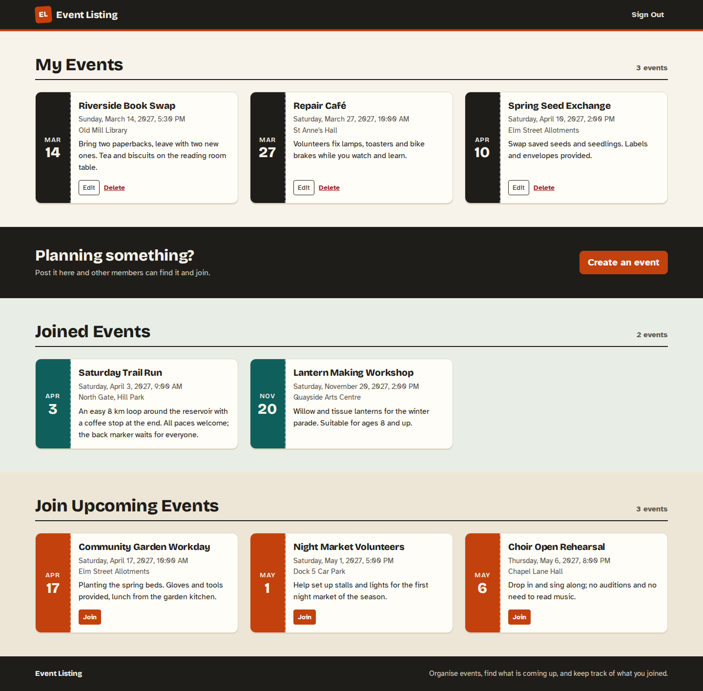
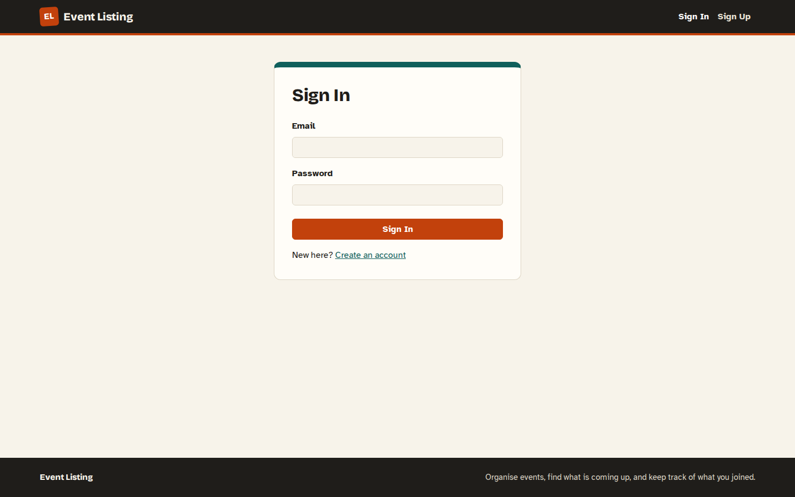
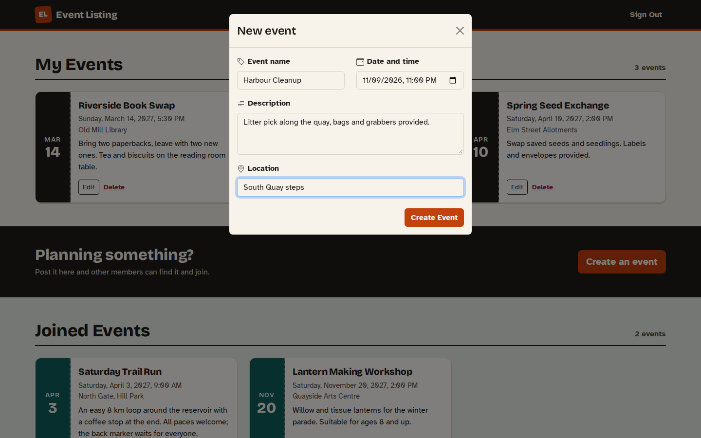
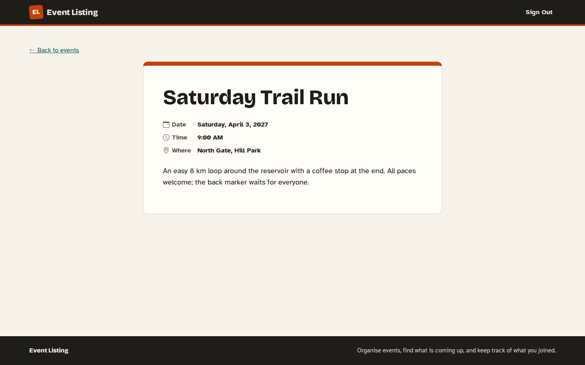
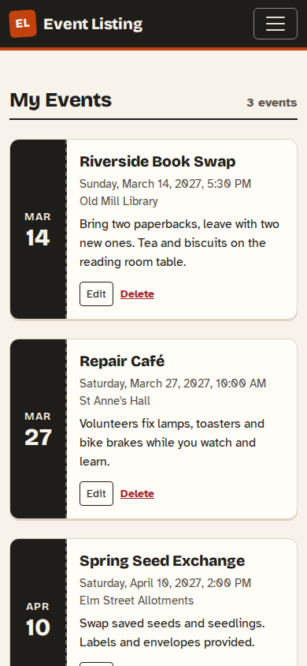
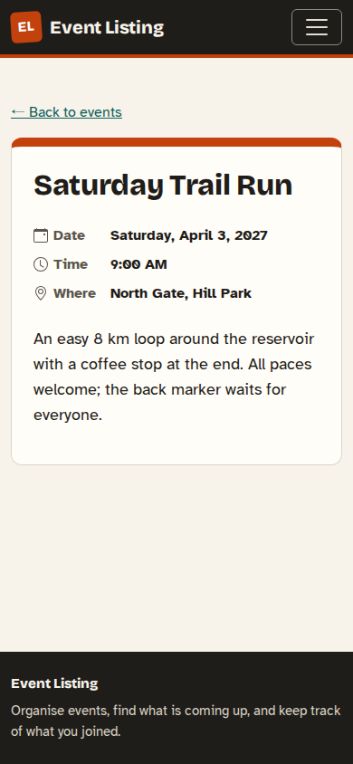
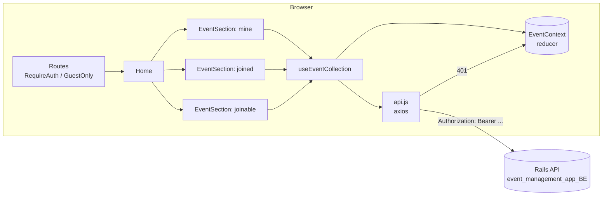

# Event Listing

A React client for a small community events board. Members sign up, post
events they are organising, browse upcoming events posted by others, and
join them. It talks to a separate Rails API (`event_management_app_BE`)
that issues JWTs and stores the events; this repository is only the
browser client.



## What you can do

- **Sign up and sign in.** Sign-in stores the JWT the API returns, and
  sends you back to the page that asked for it (an event link opened
  while signed out, for example).
- **Manage your events.** Create one from the banner, open a card to
  view it, then edit it, or delete it after a confirmation.
- **Join events.** "Join Upcoming Events" lists events you neither
  organise nor have joined. Joining moves the card to "Joined Events".
- **Read an event.** Every card except your own links to a details page
  at `/events/:id`.
- **Page through long lists.** The API returns at most one page per
  request, so each section shows a count and a "Load more" button.

Every list has its own loading spinner, empty message and error message
with a retry. API messages (403, validation errors, throttling) are shown
as they come back, not replaced with "Something went wrong".

| Sign in | New event | Event details |
|---|---|---|
|  |  |  |

| Workspace on a phone | Event on a phone |
|---|---|
|  |  |

## Running it

You need Node 22 (`.nvmrc`) and, for real data, the Rails API running
somewhere the browser can reach.

```bash
cp .env.example .env      # VITE_API_BASE_URL=http://localhost:3000, PORT=3001
npm ci
npm run dev               # http://localhost:3001
```

`VITE_API_BASE_URL` is the API origin. Leave it empty if the client and
API are served from the same origin, e.g. behind one reverse proxy. The
dev server uses port 3001 by default so it does not clash with Rails on
3000. The API already allows cross-origin requests and exposes the
`Authorization` header, which the client needs in order to read the token.

| Command | What it does |
|---|---|
| `npm run dev` | Vite dev server with hot reload |
| `npm test` | Vitest and Testing Library, with the API mocked by MSW (no backend needed) |
| `npm run lint` | ESLint with the React, hooks and jsx-a11y rules; warnings fail |
| `npm run build` | Production bundle in `dist/` |
| `npm run preview` | Serves `dist/` locally |
| `npm run screenshots` | Regenerates `docs/screenshots/` from `dist/` (see below) |

### Docker

The image builds the bundle and serves it with nginx. Vite bakes
`VITE_*` variables in at build time, so the API origin is a build
argument:

```bash
docker build --build-arg VITE_API_BASE_URL=http://localhost:3000 -t event-listing .
docker run --rm -p 8080:80 event-listing     # http://localhost:8080
```

nginx sends client routes such as `/events/7` to `index.html`. It serves
`index.html` uncached and the hashed files in `/assets/` with a one-year
lifetime, and it adds `X-Content-Type-Options`, `X-Frame-Options` and
`Referrer-Policy` to every response.

On Netlify, `public/_redirects` does the same SPA fallback.

## How it fits together



- `src/services/api.js` is the one axios instance. It attaches the
  stored token and turns a 401 on any call except `/login` and `/logout`
  into a sign-out with a single "session expired" message.
- `src/context/EventContext.jsx` holds the auth flag and the three
  collections (`mine`, `joined`, `joinable`), each stored as
  `{ items, total }`. The reducer is pure; the token is written to
  `localStorage` by `signIn`/`signOut`, not inside the reducer.
- `src/hooks/useEventCollection.js` loads one collection a page at a
  time and reports `loading`, `ready` or `error`.
- `src/services/toast.js` with `src/components/Toaster.jsx` is a
  ~60-line notification store read through `useSyncExternalStore`. It
  replaced `react-notifications`, which is unmaintained and renders a
  blank page under Vite.

## The API calls it makes

| Action | Request |
|---|---|
| Sign up | `POST /signup` with `{"user":{"name","email","password","password_confirmation"}}` |
| Sign in | `POST /login` with `{"user":{"email","password"}}`. The token comes back in the `Authorization` **response header** |
| Sign out | `DELETE /logout` |
| My events | `GET /api/v1/events?page=1&per_page=12` |
| Joined | `GET /api/v1/events/joined_events?page=1&per_page=12` |
| Joinable | `GET /api/v1/events/get_events?page=1&per_page=12` |
| One event | `GET /api/v1/events/:id` |
| Create / edit / delete | `POST /api/v1/events`, `PATCH` and `DELETE /api/v1/events/:id` with `{"event":{"name","description","date","location"}}` |
| Join | `POST /api/v1/events/add_user_to_events?event_id=:id` |

For example, creating an event sends this body, which is the shape the
tests assert (`date` is the local date and time from the form,
converted to UTC):

```json
{
  "event": {
    "name": "Harbour Cleanup",
    "description": "Litter pick along the quay.",
    "date": "2027-03-14T17:30:00.000Z",
    "location": "South Quay"
  }
}
```

The API answers with the stored event (`id`, `name`, `description`,
`date`, `location`, `organizer_id`), and the client puts that object
into the list rather than its own copy. Errors come back as
`{"errors": [...]}`, `{"attributes_errors": {"field": [...]}}` or, from
`/signup`, `{"status": [...]}`; `src/services/errors.js` turns each of
them into one readable sentence.

The token is sent back exactly as the API issued it, because it already
starts with `Bearer `. Adding the prefix in the client would double it.

## Tests

`npm test` runs 39 tests in about seven seconds, with no network.
[MSW](https://mswjs.io/) answers every request from `src/test/server.js`
and `src/test/fixtures.js`. Unhandled requests fail the test. They cover:

- sign-in storing the header token, wrong credentials, a response
  with no token, throttling (429) and the return-to-origin redirect;
- sign-out clearing the session even when the server has already
  dropped it, and an expired token signing the user out once;
- sign-up sending `password_confirmation`, mismatched passwords,
  validation messages and network failures;
- the three lists, including errors with retry, empty states and
  paging by `X-Total-Count`;
- creating, editing, deleting (including a refused 403) and joining
  events, and the details page's not-found and retry states.

## Screenshots

`docs/screenshots/` comes from a production build in headless Chromium,
using the demo events in `scripts/demo-events.json`; no backend runs. To
regenerate it, use the Playwright image that matches the pinned
`@playwright/test` version:

```bash
docker run --rm -v "$PWD":/app -w /app mcr.microsoft.com/playwright:v1.64.1-noble \
  sh -c "npm ci && npm run build && npm run screenshots"
```

Desktop shots are 1440×900 and phone shots 390×844.

## Design choices

- **Look.** Warm paper, ink, vermilion and teal, like a printed
  community noticeboard. Each card is a ticket stub with the date. The
  headings use Bricolage Grotesque and the body text Atkinson
  Hyperlegible. Both are self-hosted through Fontsource, so the app
  makes no font CDN requests.
- **Accessibility.** A skip link, a `<main>` landmark, labelled
  sections, real buttons and links instead of clickable `<div>`s,
  per-event names on Edit, Delete and Join, a labelled native
  date-time input, and a visible focus ring. `jsx-a11y` runs in lint.
- **Small dependency surface.** React 18, React Router 7,
  React-Bootstrap, axios and react-icons. CRA, styled-components, Font
  Awesome and react-datepicker were removed during the move to Vite.

## Limitations

- The token lives in `localStorage`, as the API's header-based JWT flow
  expects. Any script injected into the page could read it.
- "Load more" pages by offset. If events are added or removed between
  pages, the next page can repeat or skip an item; repeats are dropped
  by id.
- There is no profile page, and no way to leave an event you joined
  (the API has no route for leaving).

## License

MIT, see [LICENSE](LICENSE).
